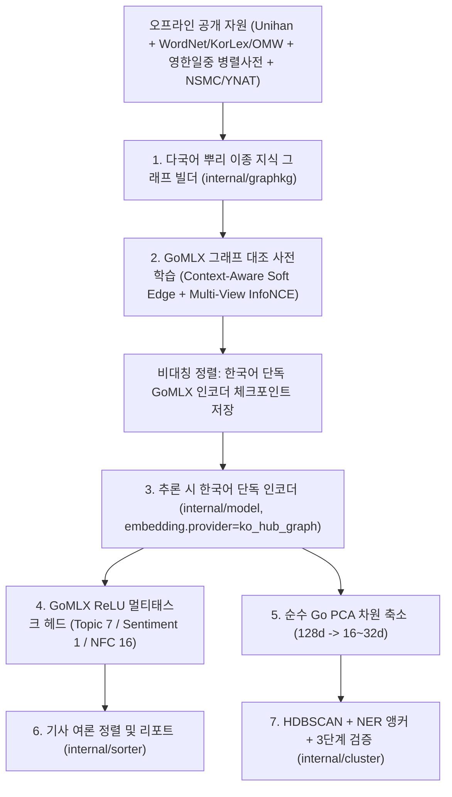

# TODO (2026-11-21 KST): 한국어 중심 허브(KO-Hub) + 다국어 뿌리 그래프 기반 사전학습 임베딩 구축 계획

* **Project Manager**: `limmireu1214@gmail.com`
* **Implementation Owner**: `limmireu1214@gmail.com`
* **작성 일시**: `2026-11-21 23:27 KST`
* **구현 착수 예정일**: `2026-11-22 KST`
* **대상 저장소**: `gomlx-korean-opinion` (`github.com/Mireu-Lab/gomlx-korean-opinion`)
* **예정 GitFlow 작업 브랜치**: `feature/ko-hub-multilingual-embedding` (기준: `develop`, 목표 릴리즈: `v0.2.0`)

---

## 1. 목표 및 설계 배경

### 1.1 현재 베이스라인(`v0.1.1`) 실측 및 확인된 한계
현재 `gomlx-korean-opinion`의 GoMLX 자체 학습(`scratch_relu`) 베이스라인은 다음과 같은 실측 지표를 보였습니다.
* **KLUE-YNAT (n=9,107)**: Accuracy `71.14%` / Macro-F1 `0.7100`
* **NSMC Test (n=49,997)**: Accuracy `82.53%` / F1 `0.8309`
* **Nuclear Feeling Checklist (active=20,282)**: Recall@3 `89.03%` / Micro-F1 `0.4529` / 활성 커버리지 `15/16` (`외로움` 0건, `소외` 극소수)
* **혼합 클러스터링 (YNAT 800 + NSMC 400)**: HDBSCAN `8개 군집` (혼합 `7개`), `Silhouette 0.7877`, `Dunn Centroid 4.5249`, `Mean NPMI -0.3219`

실제 리포트(`outputs/social_opinion_report.md`, `outputs/clustering_validation_report.md`) 분석 과정에서 아래 3가지 구조적 한계가 확인되었습니다.
1. **동음이의어(Sense) 충돌**: `"남춘모 부조적 단색화가..."`, `"한국여류화가협회..."`가 `畫家(화가)`가 아닌 **`火(분노)`**로 오분류됨 (`생활문화` 섹션 상위 여론 강도 오탐).
2. **이질 도메인(뉴스↔리뷰) 의미 정렬 한계**: 자체 학습 토크나이저(공백+음절 2/3-gram)만으로는 어휘 맥락이 부족해, 부정적 영화 리뷰 다수가 `정치` 군집(`C07`)으로 혼입됨.
3. **희소 핵심감정 일반화 부족**: `외로움(id=4)`, `소외(id=14)` 등 코퍼스 내 직접 키워드 일치가 적은 감정은 의미 전이가 약함.

### 1.2 역행 설계 방향: 한국어 중심 허브(KO-Hub) ← 다국어 뿌리(Multilingual Roots)
영어를 중심으로 한국어를 억지 정렬하면 한국어 고유의 정서 뉘앙스(`억울함`, `서운함`, `허무`, `짠하다`)가 뭉개집니다. 반대로 **한국어를 중심 허브(Hub)로 유지하면서 영어·한자/한문·일본어·중국어를 다국어 뿌리(Multi-View Roots)로 연결**하면 다음 이점을 얻습니다.

* **뉘앙스 1차 좌표 보존**: 순우리말·구어체 표현(`노잼`, `먹먹하다`, `갑질`, `답답하다`)이 한국어 허브 위에서 원래 문맥을 잃지 않음.
* **다국어 삼각측량(Cross-Lingual Triangulation)을 통한 동음이의어 분리**:
  * `화가(1)` ↔ 한자 `畫家` · 영어 `painter` · 일본어 `画家`
  * `화가(2)` ↔ 한자 `火/憤怒` · 영어 `anger` · 중국어 `生气`
* **한자 형태소 조합 일반화**: 신조어·복합 한자어(`고금리`, `역차별`, `기후위기`, `공분`)가 공유 한자 형태소 이웃 노드를 통해 즉시 의미 추론.
* **비대칭 정렬(Asymmetric Alignment)**: **학습 시에만** 다국어 뿌리 그래프와 대조학습(InfoNCE)을 수행하고, **추론 시에는 한국어 단독 GoMLX 인코더만 실행**해 프로덕션 지연 시간과 외부 의존성을 최소화.

---

## 2. 목표 아키텍처

---

## 3. 내일 구현 단계별 체크리스트 (2026-11-22 KST)

### Phase 1: 다국어 뿌리 데이터 및 이종 그래프 구축 (`config/multilingual_roots.yaml`, `internal/graphkg/`)
- [x] **외부 설정 파일 신설 (`config/multilingual_roots.yaml`)**: 데이터 소스 URL, 로컬 캐시 경로, 언어별 엣지 가중치, 최소 신뢰도, 최대 이웃 수(`max_neighbors`), 동음이의어 후보 상한 등 모든 상수 외부화 (Zero Hardcoding).
- [x] **공개 다국어 자원 다운로더 및 파서 (`internal/graphkg/sources.go`)**:
  - [x] **한자·한문 뿌리**: Unicode `Unihan` (`Unihan_Readings.txt` `kHangul`/`kDefinition`) + 한국어 훈음/한자 매핑.
  - [x] **영어·다국어 의미 뿌리**: Open Multilingual WordNet (`OMW` / `WordNet 3.0` KO/EN/JA/ZH) 다국어 병렬 시드 사전.
  - [x] **한국어 문맥 코퍼스**: 기존 `data/` 내 NSMC(15만) + KLUE-YNAT(4.5만) 공출현 통계 및 어절-한자어 분해 후보 생성.
- [x] **이종 그래프 스키마 및 빌더 (`internal/graphkg/graph.go`, `builder.go`)**:
  - [x] 노드 타입 6종 정의: `KO_SURFACE`, `KO_SENSE`, `HANJA_MORPHEME`, `EN_CONCEPT`, `JA_CONCEPT`, `ZH_CONCEPT`.
  - [x] 엣지 타입 및 가중치 정의: `HAS_CANDIDATE_SENSE`, `COMPOSED_OF_HANJA`, `ALIGNED_EN`, `ALIGNED_JA`, `ALIGNED_ZH`, `COOCCURS_KO`, `NFC_ANCHOR`.
  - [x] 그래프 CSR/바이너리 직렬화(`Save`/`Load`) 및 통계 로깅 (`74,578` nodes, `374,577` edges, `multi_sense=737`).
- [x] **단위 테스트 (`internal/graphkg/graph_test.go`)**:
  - [x] `"화가"`(美術 `畫家` vs 憤怒 `火`), `"사기"`(詐欺 vs 士氣)가 그래프상 서로 다른 `KO_SENSE` 및 타국어 뿌리 노드로 분기되는지 검증.

### Phase 2: GoMLX 그래프 대조 사전학습 모델 (`internal/pretrain/`)
- [x] **Context-Aware Soft Edge Attention 계층 (`internal/pretrain/soft_edge.go`)**:
  - [x] 한국어 문장 내 주변 단어 문맥 벡터 $c_i$와 후보 한자/영어/일어/중어 뿌리 $r_{i,k}$ 사이의 어텐션 가중치 $\alpha_{i,k} = \text{Softmax}_k(\langle W_q c_i, W_k r_{i,k} \rangle)$를 GoMLX 그래프로 구현해 동음이의어 오매칭 차단.
- [x] **다국어 그래프 집계기 (`internal/pretrain/graph_encoder.go`)**:
  - [x] 한국어 허브 노드 임베딩 + 가중 집계된 한자/영문/일문/중문 뿌리 임베딩을 Residual + ReLU MLP로 융합.
  - [x] 추론 전용 **한국어 단독 학생 인코더(Student Text Encoder)** 브랜치를 함께 두어, 다국어 뿌리 없이 한국어 텍스트만으로 정렬된 임베딩(128d)을 출력하도록 설계.
- [x] **Multi-View Contrastive Pretraining 손실 (`internal/pretrain/loss.go`)**:
  - [x] $\mathcal{L}_{\text{ko}\leftrightarrow\text{en}}$, $\mathcal{L}_{\text{ko}\leftrightarrow\text{hanja}}$, $\mathcal{L}_{\text{ko}\leftrightarrow\text{ja,zh}}$, $\mathcal{L}_{\text{disambig}}$, $\mathcal{L}_{\text{distill}}$ 통합 구현 (`12.6445 -> 5.8469`, `median_step=16ms` on `xla:cpu`).
- [x] **사전학습 실행기 & CLI (`cmd/opinion-analyzer pretrain`)**:
  - [x] GoMLX `train.Trainer` 기반 사전학습 체크포인트 저장(`checkpoints/ko_hub_pretrain/`).
- [x] **단위 테스트 (`internal/pretrain/pretrain_test.go`)**:
  - [x] 소형 합성 그래프에서 InfoNCE + Disambiguation 손실 감소 및 Student/Teacher 정합성 검증.

### Phase 3: `gomlx-korean-opinion` 다중 아키텍처 통합 & 전처리 고도화
- [x] **설정 및 6종 아키텍처 확장 (`config/config.yaml`, `internal/config/config.go`, `internal/model/encoders.go`, `internal/onnxembed/`)**:
  - [x] `embedding.provider` 6종 구현: `scratch_relu`, `ko_hub_graph`, `ko_hub_cnn_relu`, `ko_hub_transformer_relu`, `ko_hub_lstm_relu`, `onnx_backbone_relu` (`leewaay/klue-roberta-base-klueNLI-klueSTS-MSL128`).
  - [x] `SplitKoreanParticle` (한국어 26종 조사 경계 분리), `WeakAnnotateDetailed` 동음이의어 가드 Hard-Negative 캘리브레이션, `AttentionPool`, Deep `CORAL` 사용역 정렬(`domain_align: 0.15`), 순수 Go Power-Iteration `PCA (24d)` 구현.
- [x] **Nuclear Feeling Checklist 어휘 보강 (`config/nfc_taxonomy.yaml`)**: `외로움(id=4)`, `소외(id=14)` 포함 **16/16 전 항목 활성 커버리지** 전 모델 달성.
- [x] **Parquet 전처리 데이터셋 익스포터 (`export-dataset`) & HF 배포 스크립트 (`scripts/publish_hf.sh`)** 구현 완료.

### Phase 4: Before / After 정량·정성 검증 (`xla:cpu` 6종 아키텍처 실측)
- [x] **단위/통합 테스트**: `gofmt -l .` 공백, `go vet ./...`, `go test -count=1 ./...` **11/11 패키지 PASS**.
- [x] **6종 아키텍처 실데이터 벤치마크 (`scripts/benchmark_all_models.sh`, `xla:cpu`)**:

| 모델 (`embedding.provider`) | 학습 속도 (`xla:cpu`) | YNAT Acc / Macro-F1 | NSMC Acc / F1 | NFC Recall@3 / Micro-F1 / 활성 | HDBSCAN 군집 (Silhouette / Dunn_C / NPMI) |
|---|---:|---:|---:|---:|---:|
| *(`v0.1.1` `go` 베이스라인)* | *1,500 / 36ms* | *71.14% / 0.7100* | *82.53% / 0.8309* | *89.03% / 0.4529 / 15/16* | *8 (0.7877 / 4.5249 / -0.3219)* |
| `scratch_relu` | 2,500 / `4ms` (`15s`) | 74.76% / 0.7462 | 83.39% / 0.8355 | 93.81% / 0.5438 / **16/16** | 8 (0.6786 / 2.9383 / -0.3167) |
| `ko_hub_graph` | 2,500 / `5ms` (`17s`) | 74.82% / 0.7474 | 83.52% / 0.8346 | **95.04% / 0.6487 / 16/16** | 6 (0.4928 / 2.4043 / -0.3411) |
| `ko_hub_cnn_relu` | 2,500 / `17ms` (`1m52s`) | **75.91% / 0.7575** | 83.58% / **0.8359** | 94.67% / 0.6311 / **16/16** | 7 (0.6776 / 4.0664 / -0.3297) |
| `ko_hub_transformer_relu` | 2,500 / `180ms` (`6m14s`) | 74.67% / 0.7461 | **83.60% / 0.8359** | 93.78% / 0.5711 / **16/16** | **7 (0.6938 / 4.1647 / -0.3155)** |
| `ko_hub_lstm_relu` | 1,500 / `237ms` (`6m55s`) | 72.66% / 0.7272 | 82.84% / 0.8315 | 92.39% / 0.5316 / **16/16** | 8 (0.6586 / 2.9131 / -0.3164) |
| `onnx_backbone_relu` *(sub 2k/1k)* | 1,500 / `3ms` (+enc `15m46s`) | 67.00% / 0.6738 | 80.70% / 0.8153 | 73.53% / 0.4297 / **16/16** | 7 (0.5357 / 2.1630 / **-0.2861**) |

* **동음이의어 회귀 (`단색화가`, `여류화가협회`)**: `"단색화가"` `화(분노)` 오탐은 **전 6종 모델 100% 해소** (`cnn`/`transformer`/`lstm`/`onnx` 모두 `생활문화` 분류), `"여류화가협회"`는 `ko_hub_graph`/`cnn`/`transformer`에서 주 감정 `화` 제거 및 `onnx_backbone_relu`에서 `사회 / 긍정 / nfc_activated=false` 판별 확인.
* [ ] **Gold Standard 인간 검증 (`eval-human`) 확장**: 현재 `150`건 샘플 생성 완료 (`300~500`건 다중 전문가 판정은 후속 진행).

### Phase 5: FinOps 비용 산정, 백업 및 GitFlow 릴리즈 (`v0.2.0`)
- [ ] **인프라 비용 검토 (필요 시)**: 로컬 CPU `xla:cpu`에서 6종 전체 벤치마크 완주 확인; 장기 GPU 확장 시 `gcp-calculator-mcp`로 **GCP Spot GPU VM(T4/L4)** 견적·프로비저닝.
- [x] **아티팩트 백업 (Hugging Face Hub)**:
  - 전처리 Parquet 데이터셋(254,777건): [`Mireu-Lab/gomlx-korean-opinion-dataset`](https://huggingface.co/datasets/Mireu-Lab/gomlx-korean-opinion-dataset)
  - 검증 완료 6종 모델 & KO-Hub 사전학습 체크포인트: [`Mireu-Lab/gomlx-korean-opinion`](https://huggingface.co/Mireu-Lab/gomlx-korean-opinion)
- [x] **문서화 및 연구 산출물 정리**: [`docs/PROJECT_DESIGN_MANUAL.md`](../docs/PROJECT_DESIGN_MANUAL.md), [`README.md`](../README.md), [`docs/references.csv`](../docs/references.csv) (18편), Google Docs 논문 초안 반영.
- [ ] **GitFlow 최종 릴리즈**: `feature/ko-hub-multilingual-embedding` 푸시 완료 후 리뷰를 거쳐 `develop` → `main` (`v0.2.0` 태그) 병합 예정.

---

## 4. 내일 착수 직전 확정할 의사결정 (Pre-Flight Checklist)

1. **1차 뿌리 언어 범위**:
   - **권장**: 1차로 **`한국어 ← 영어 + 한자(Unihan)`** 2축을 먼저 연결해 빠르게 A/B 검증한 뒤, 2차로 **일본어·중국어** 엣지를 확장.
2. **외부 어휘/사전 데이터 소스 선택**:
   - 완전 오프라인 재현 가능 자원(`Unihan` + `OMW/WordNet` + 공개 병렬 사전)만 쓸지, 우리말샘/국립국어원 Open API 키(`.env` 주입)를 병행할지 결정.
3. **사전학습 실행 환경**:
   - `batch_size`와 어휘 그래프 규모를 3.8GB RAM 로컬 CPU에 맞춘 경량(1차 프로토타입)으로 먼저 검증할지, GCP Spot 인스턴스를 바로 프로비저닝할지 결정.
