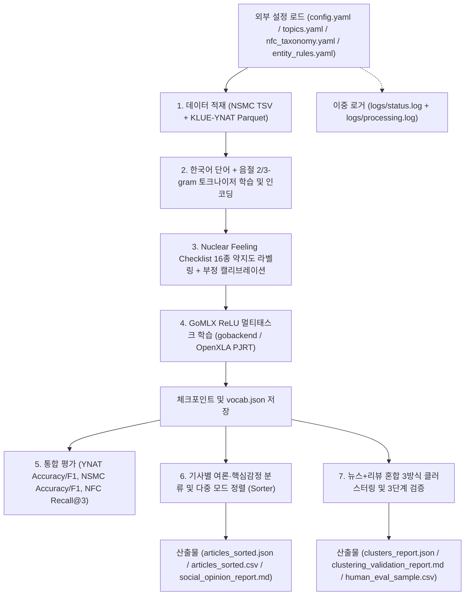
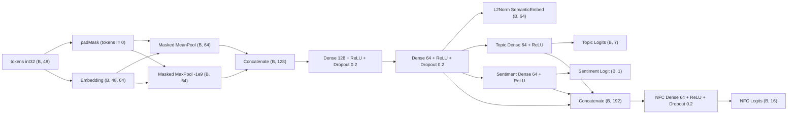

# GoMLX ReLU 기반 한국어 사회적 여론·핵심감정 분류 및 다차원 뉴스·리뷰 클러스터링 프로젝트 설계 매뉴얼

* **Project Manager**: `limmireu1214@gmail.com`
* **Implementation Owner**: `limmireu1214@gmail.com`
* **Module Path**: `github.com/Mireu-Lab/gomlx-korean-opinion`
* **Tech Stack**: Go `1.27` · GoMLX `v0.28.38` · `gomlx/compute v0.1.32` · `gomlx/go-xla v0.4.32` · `parquet-go v0.32.1` · `yaml.v3 v3.0.1`
* **작성 기준일 (UTC)**: 2026-11-21

---

## 1. 문서 개요 및 프로젝트 설계 원칙

### 1.1 해결하고자 하는 문제
본 프로젝트는 **스타일과 어휘 분포가 상이한 두 한국어 말뭉치**를 하나의 통합 파이프라인에서 결합하여 사회적 여론을 입체적으로 분석·정렬·군집화하는 것을 목표로 합니다.

1. **기사 주제 분류 (KLUE-YNAT)**: 객관적·사실 전달 중심의 연합뉴스 헤드라인 7개 주제(`IT과학`, `경제`, `사회`, `생활문화`, `세계`, `스포츠`, `정치`) 분류
2. **여론 극성 판별 (NSMC)**: 주관적·구어체·감성 중심의 네이버 영화 리뷰 기반 긍정/부정 여론 극성 학습
3. **Nuclear Feeling Checklist 기반 핵심감정 분류 및 여론 정렬**: 김경민(2006/2019)의 **16개 핵심감정 체크리스트** 및 **8개 학술 요인군**을 약지도 다중 라벨(Multi-label)로 학습하고, 기사별 사회적 여론 강도(Social Opinion Intensity)를 정량화하여 정렬
4. **이질적 도메인(뉴스 ↔ 리뷰) 통합 클러스터링 및 3단계 검증**: 표면적 문체 차이를 넘어 의미 임베딩(`HDBSCAN`), 고유명사·이슈 앵커(`NER`), 계층적 주제(`c-TF-IDF` / 선택적 LLM)로 통합 군집화하고 수학적·일관성·인간 검증을 수행

### 1.2 핵심 엔지니어링 원칙
* **Pure Go (Zero Python)**: 데이터 다운로드, Parquet 파싱, 한국어 토크나이징, GoMLX 신경망 학습·추론, HDBSCAN 클러스터링, 평가·리포트 생성까지 전 과정을 순수 Go로 구현하여 단일 바이너리(`bin/opinion-analyzer`)로 실행합니다.
* **Zero Hardcoding**: 모든 URL, 파일 경로, 토크나이저 규격, 모델 구조, 손실 가중치, 정렬 기준, 7개 주제 정의, 16개 핵심감정 어휘 사전, NER 규칙, 클러스터링 및 검증 임계값은 `config/*.yaml`, 환경변수, CLI 플래그로만 주입합니다.
* **Dual Logging Standard**: Jenkins 스타일의 파이프라인 단계 로그(`logs/status.log`)와 Log4j 스타일의 상세 구조화 로그(`logs/processing.log`)를 동시에 기록합니다.
* **Verification First**: 모든 모듈의 단위 테스트(`go test`)와 실제 NSMC + KLUE-YNAT 데이터셋 기반 엔드투엔드 검증을 통과한 수치만을 기준으로 동작을 보장합니다.

---

## 2. 전체 시스템 아키텍처 및 데이터 흐름

### 2.1 엔드투엔드 파이프라인 흐름



### 2.2 OpenXLA / PJRT 백엔드 및 JAX 생태계 호환 구조
* **공유 컴파일러 기반**: JAX가 연산 그래프를 OpenXLA의 중간 표현인 **StableHLO**로 내리고 **PJRT** 런타임을 통해 CPU/GPU/TPU에서 실행하듯, GoMLX 역시 `gomlx/compute` 추상화 위에서 **OpenXLA/PJRT 백엔드(`gomlx/go-xla`)**와 순수 Go **SimpleGo 백엔드(`gobackend`, `"go"`)**를 선택적으로 구동합니다.
* **빌드 분리 설계**:
  * `internal/model/backend.go`: 기본 `"go"` 백엔드(`github.com/gomlx/compute/gobackend`) 항상 등록
  * `internal/model/backend_xla.go`: `//go:build !noxla` 태그를 통해 Linux/macOS/Windows에서 `github.com/gomlx/go-xla/compute/xla/autoinstall` 등록
* **실행 전환**: 코드 수정 없이 `config/config.yaml`의 `runtime.backend`, `GOMLX_BACKEND`/`NFC_BACKEND` 환경변수, 또는 `--backend` 플래그(`go`, `xla`, `xla:cpu`, `xla:cuda`)로 백엔드를 전환할 수 있습니다.
* **JAX 상호운용성 경로**: JAX에서 학습한 모델을 OpenXLA/PJRT 기반 Go 런타임에서 서빙해야 하는 경우, 계산 그래프는 StableHLO IR로, 가중치는 중립 텐서 포맷(Safetensors/ONNX/raw array)으로 분리 내보내기하여 연동하는 구조를 따릅니다.

---

## 3. 저장소 구조 및 패키지 모듈 설계

### 3.1 디렉터리 구조

```text
gomlx-korean-opinion/
├── cmd/
│   └── opinion-analyzer/
│       └── main.go                 # CLI 진입점 (7개 서브커맨드 오케스트레이션)
├── config/
│   ├── config.yaml                 # 런타임, 경로, 데이터셋, 토크나이저, 모델, 학습, 정렬, 클러스터링 설정
│   ├── topics.yaml                 # KLUE-YNAT 7개 주제 메타데이터 및 정렬 순서
│   ├── nfc_taxonomy.yaml           # Nuclear Feeling Checklist 16개 핵심감정, 8요인군, 어휘 사전
│   └── entity_rules.yaml           # NER 규칙(기관/지역/인명직함/작품트리거/공적이슈) 및 불용어
├── docs/
│   └── PROJECT_DESIGN_MANUAL.md    # 본 설계 매뉴얼
├── internal/
│   ├── config/                     # YAML 파싱, 환경변수 오버라이드, 엄격 검증
│   ├── logging/                    # Jenkins status.log + Log4j processing.log 이중 로거
│   ├── nfc/                        # Topic/NFC 분류체계 로더 및 약지도 어노테이터
│   ├── tokenizer/                  # 한국어 정규화, 단어 + 2/3-gram 어휘 구축 및 인코딩
│   ├── data/                       # HTTP 다운로더, NSMC/YNAT/커스텀 로더, 균형 멀티태스크 Dataset
│   ├── model/                      # GoMLX ReLU 네트워크, 마스킹 손실, 학습 루프, 정적 추론기
│   ├── sorter/                     # NFC 보정, 여론 강도 스코어링, 4종 정렬기, 교차 매트릭스/리포트
│   └── cluster/                    # HDBSCAN, NER 앵커, c-TF-IDF 계층 명명, 3단계 검증 및 리포트
├── scripts/
│   └── run_pipeline.sh             # Bash 파이프라인 실행기 (set -euo pipefail)
├── go.mod
├── go.sum
└── README.md
```

### 3.2 패키지별 책임 및 주요 심볼

| 패키지 | 파일 | 핵심 심볼 및 역할 | 주요 의존 |
|---|---|---|---|
| `cmd/opinion-analyzer` | `main.go` | `runCommand`, `stageDownload`, `stageTrain`, `stageEval`, `stageAnalyze`, `stageCluster`, `stageEvalHuman` | 전체 `internal/*` |
| `internal/config` | `config.go` | `Config`, `Load`, `applyEnvOverrides`, `Validate`, `ValidSortModes` | `yaml.v3` |
| `internal/logging` | `logger.go` | `DualLogger`, `NewDualLogger`, `Status`, `Debug`/`Info`/`Warn`/`Error` | 표준 라이브러리 |
| `internal/nfc` | `taxonomy.go` | `Taxonomy`, `TopicDef`, `FeelingDef`, `LoadTaxonomy`, `WeakAnnotate`, `SortedTopicsByDisplayOrder` | `yaml.v3` |
| `internal/tokenizer` | `tokenizer.go` | `Tokenizer`, `Normalize`, `ExtractTokens`, `Fit`, `Encode`, `Save`/`Load` | `internal/config` |
| `internal/data` | `downloader.go`, `loader.go`, `dataset.go` | `EnsureDatasets`, `LoadNSMC`, `LoadYNAT`, `LoadCustomArticles`, `PrepareExamples`, `MultiTaskTrainDataset` | `parquet-go`, `gomlx/ml/train` |
| `internal/model` | `relu_nlp.go`, `loss.go`, `train.go`, `infer.go` | `BuildGraphWithEmbedding`, `BuildLogits`, `BuildMultiTaskLoss`, `Train`, `Evaluate`, `Predictor`, `LoadPredictor` | `gomlx`, `compute` |
| `internal/sorter` | `sorter.go` | `ScoreArticles`, `SortArticles`, `BuildReport`, `WriteOutputs` | `internal/nfc`, `internal/data` |
| `internal/cluster` | `hdbscan.go`, `entity.go`, `hierarchy.go`, `validate.go`, `report.go` | `BuildHybridVectors`, `RunHDBSCAN`, `EntityExtractor`, `BuildEntityGroups`, `ComputeClusterTopKeywords`, `ComputeSilhouette`, `ComputeDunnIndex`, `ComputeTopicCoherence`, `ExportHumanEvalSample`, `ScoreHumanEvalCSV`, `RunClusteringPipeline` | `internal/sorter`, `internal/tokenizer`, `internal/nfc` |

---

## 4. 데이터 파이프라인 및 한국어 토크나이저 설계

### 4.1 입력 데이터셋 스키마 및 파서
1. **NSMC (`internal/data/loader.go` -> `LoadNSMC`)**
   * 포맷: UTF-8 TSV (`id \t document \t label`)
   * `label`: `0`(부정), `1`(긍정). 공백 문서 및 손상 행은 스킵 카운트로 추적합니다 (`TopicID = -1`, `HasTopic = false`, `HasSentiment = true`).
2. **KLUE-YNAT (`internal/data/loader.go` -> `LoadYNAT`)**
   * 포맷: Hugging Face Parquet (`guid`, `title`, `label`, `url`, `date`)
   * 순수 Go `parquet.ReadFile[ynatParquetRow]`로 직접 디코딩합니다 (`HasTopic = true`, `HasSentiment = false`).
3. **외부 기사 입력 (`LoadCustomArticles`)**
   * `.jsonl`/`.ndjson`, `.csv`, `.tsv` 지원 (`id`/`guid`, `title`/`headline`, `text`/`content`/`document`/`body`, `date`/`published_at`, `url`/`link` 필드 자동 매핑).

### 4.2 단어 우선 + 음절 n-gram 한국어 토크나이저
* **정규화 (`tokenizer.Normalize`)**: ASCII 소문자화, 한글 음절(`0xAC00..0xD7A3`)·자모·영숫자를 제외한 문장부호/제어문자 공백 치환.
* **토큰 추출 순서 (`tokenizer.ExtractTokens`)**:
  1. `"w:<어절>"` 전체 어절 토큰을 먼저 추출
  2. `use_char_bigrams: true` 시 `"2:<2음절>"` 추출
  3. `use_char_trigrams: true` 시 `"3:<3음절>"` 추출
  * **설계 의도**: 고정 길이(`max_seq_len: 48`) 절단 시 앞부분 n-gram 때문에 문장 후반 어절이 잘리는 현상을 방지하고, 헤드라인과 긴 영화 리뷰 모두 문맥 전체를 우선 보존하면서 형태소 분석기 없이도 한국어 복합어/활용형 일반화를 확보합니다.
* **특수 ID**: `<PAD> = 0`, `<UNK> = 1`, 빈도 순 상위 `vocab_size` (`20,000`)까지 `vocab.json`에 영속화합니다.

### 4.3 약지도 라벨링 및 균형 멀티태스크 배칭
* **약지도 + 부정 캘리브레이션 (`PrepareExamples`)**:
  * `WeakAnnotate(text)` 결과 1개 이상 핵심감정이 매칭되면 `NFCMask = 1.0`.
  * 매칭이 0건일 때에도 긍정 리뷰(`HasSentiment && SentimentLabel >= 0.5`)는 `nfc_negative_calibration_prob (0.35)` 확률로, 중립/비매칭 뉴스는 `0.15 * 0.35` 확률로 `NFCMask = 1.0` + 영벡터(`0`) 타깃을 부여합니다. 이는 모델이 모든 입력에 높은 핵심감정 점수를 출력하는 과잉 활성(Over-triggering)을 방지합니다.
* **균형 미니배치 (`MultiTaskTrainDataset`)**:
  * 매 배치(`B = 64`)를 `ynat_batch_ratio (0.45)`와 `nsmc_batch_ratio (0.55)` 비율로 조합하고, 각 도메인 슬롯 내부의 `nfc_positive_sample_ratio (0.50)`를 NFC 활성 샘플에서 추출한 뒤 행 순서를 셔플합니다. 이를 통해 16개 희소 핵심감정과 두 도메인 간 그래디언트 균형을 유지합니다.

---

## 5. GoMLX ReLU 멀티태스크 신경망 및 손실 함수 설계

### 5.1 신경망 계층 구조 및 텐서 형상



* **핵심 구현 포인트 (`internal/model/relu_nlp.go`)**:
  * **Zero-Division / All-PAD 방어**: `safeLengths = Max(lengths, 1.0)`으로 평균 풀링 나눗셈 안전성을 보장하고, 최대 풀링은 PAD 위치에 `-1e9`를 채운 뒤 `lengths == 0`인 빈 입력 행은 0으로 마스킹합니다.
  * **조건부 핵심감정 헤드**: NFC 은닉층이 공유 표현 `h` 뿐 아니라 주제 은닉 `topicH`와 감성 은닉 `sentH`를 함께 결합(`Concatenate [B, 192]`)하여, 동일 단어라도 뉴스 주제와 부정/긍정 맥락에 따라 핵심감정을 조건부로 추론합니다.
  * **Scope 정합성**: 학습(`train.NewTrainer`)과 추론(`model.NewExec`) 모두 `scope.In("relu_nlp")` 하위 경로를 공유하여 체크포인트 저장·복원 시 변수 경로가 100% 일치합니다. 추론기(`Predictor`)는 `scope.Store().SetTraining(g, false)`를 명시해 드롭아웃을 비활성화합니다.
  * **정적 배치 패딩**: `PredictExamples`는 마지막 잔여 배치를 `eval_batch_size (128)` 크기로 패딩해 단일 그래프만 컴파일하고 결과 슬라이스만 잘라 반환합니다.

### 5.2 NaN-Safe 마스킹 멀티태스크 손실 함수 (`internal/model/loss.go`)
하나의 배치에 YNAT(토픽만 보유)과 NSMC(감성만 보유)가 섞여 있으므로 각 태스크는 전용 마스크(`topicMask`, `sentMask`, `nfcMask`)를 통해 해당 샘플에 대해서만 평균 손실을 계산합니다. 분모는 항상 `max(sum(mask), mask_epsilon)`으로 클램핑합니다.

1. **주제 손실 (Masked Sparse Categorical Cross-Entropy)**:
   $$\mathcal{L}_{\text{topic}} = \frac{\sum_{b=1}^{B} m^{\text{topic}}_b \cdot \left(-\sum_{k=0}^{6} \mathbf{1}[y^{\text{topic}}_b = k] \log \text{Softmax}(z^{\text{topic}}_b)_k\right)}{\max\left(\sum_{b=1}^{B} m^{\text{topic}}_b,\, \varepsilon\right)}$$
2. **감성 손실 (Masked Numerically-Stable BCE with Logits)**:
   $$\ell^{\text{sent}}_b = \max(z_b, 0) - z_b y_b + \log(1 + e^{-|z_b|}), \quad \mathcal{L}_{\text{sent}} = \frac{\sum_{b} m^{\text{sent}}_b \ell^{\text{sent}}_b}{\max(\sum_{b} m^{\text{sent}}_b, \varepsilon)}$$
3. **핵심감정 손실 (Positive-Weighted Masked Multi-Label BCE)**:
   * 다중 라벨 희소성(16개 중 평균 1~2개 활성)을 보정하기 위해 양성 가중치 `nfc_pos_weight = 6.0`을 적용합니다.
   $$\ell^{\text{nfc}}_{b,c} = w_{\text{pos}} y_{b,c}\left(\max(-z_{b,c}, 0) + \log(1+e^{-|z_{b,c}|})\right) + (1-y_{b,c})\left(\max(z_{b,c}, 0) + \log(1+e^{-|z_{b,c}|})\right)$$
   $$\mathcal{L}_{\text{nfc}} = \frac{\sum_{b=1}^{B} m^{\text{nfc}}_b \left(\frac{1}{16}\sum_{c=0}^{15} \ell^{\text{nfc}}_{b,c}\right)}{\max(\sum_{b=1}^{B} m^{\text{nfc}}_b, \varepsilon)}$$
4. **총 손실**:
   $$\mathcal{L}_{\text{total}} = w_{\text{topic}}\mathcal{L}_{\text{topic}} + w_{\text{sent}}\mathcal{L}_{\text{sent}} + w_{\text{nfc}}\mathcal{L}_{\text{nfc}} \quad (w_{\text{topic}}=1.0,\; w_{\text{sent}}=1.0,\; w_{\text{nfc}}=1.5)$$

---

## 6. Nuclear Feeling Checklist 분류체계 및 기사 여론 정렬 알고리즘

### 6.1 16개 핵심감정 & 8개 학술 요인군 참조표 (`config/nfc_taxonomy.yaml`)

| ID | 코드 | 한국어명 | 영문명 | 학술 요인군 (`factor_group`) | 사회 여론 가중치 (`social_weight`) | 극성 친화도 |
|---:|---|---|---|---|---:|---|
| 0 | `burden` | 부담감 | Burden | 무기력/압박 | 0.95 | `negative` |
| 1 | `competitiveness` | 경쟁심 | Competitiveness | 경쟁심 | 0.85 | `competitive` |
| 2 | `unfairness` | 억울함 | Unfairness | 적개심/억울 | 1.15 | `negative` |
| 3 | `inferiority` | 열등감 | Inferiority | 소외/위축 | 0.85 | `negative` |
| 4 | `loneliness` | 외로움 | Loneliness | 소외 | 0.90 | `negative` |
| 5 | `longing` | 그리움 | Longing | 화/친밀감 | 0.75 | `mixed` |
| 6 | `jealousy` | 질투 | Jealousy | 질투/경쟁 | 0.85 | `negative` |
| 7 | `fear` | 두려움 | Fear | 공포 | 1.05 | `negative` |
| 8 | `anger` | 화 | Anger | 화/친밀감 | 1.20 | `negative` |
| 9 | `helplessness` | 무기력 | Helplessness | 무기력 | 1.00 | `negative` |
| 10 | `emptiness` | 허무 | Emptiness | 무기력 | 0.90 | `negative` |
| 11 | `sadness` | 슬픔 | Sadness | 소외/슬픔 | 1.05 | `negative` |
| 12 | `anxiety` | 불안 | Anxiety | 불안 | 1.10 | `negative` |
| 13 | `terror` | 공포 | Terror | 공포 | 1.15 | `negative` |
| 14 | `alienation` | 소외 | Alienation | 소외 | 1.00 | `negative` |
| 15 | `hostility` | 적개심 | Hostility | 적개심 | 1.20 | `negative` |

### 6.2 보정 점수, 여론 강도 스코어링 및 정렬 모드 (`internal/sorter/sorter.go`)
* **보정 핵심감정 점수 (Calibrated Score)**:
  $$s_c = \frac{w_{\text{neural}} \cdot p^{\text{neural}}_c + w_{\text{lexical}} \cdot s^{\text{lex}}_c}{w_{\text{neural}} + w_{\text{lexical}}} \quad (w_{\text{neural}}=0.85,\; w_{\text{lexical}}=0.15)$$
  여기서 어휘 점수 $s^{\text{lex}}_c = \min(1.0,\, \text{hits}_c / \text{lexical\_saturation})$ ($\text{lexical\_saturation}=2.0$)입니다.
* **감성 판정 라벨**: 긍정 확률 $p_{\text{pos}} \ge 0.60 \rightarrow \text{긍정}$, $p_{\text{pos}} \le 0.40 \rightarrow \text{부정}$, 그 외 $\rightarrow \text{중립}$.
* **사회적 여론 강도 (Social Opinion Intensity)**:
  가중 감정 점수 $ws_c = s_c \cdot \text{social\_weight}_c$를 내림차순 정렬한 뒤 다음과 같이 산출합니다.
  $$I = \frac{0.55 \cdot \max_c(ws_c) + 0.25 \cdot \text{mean}(\text{top3}(ws)) + 0.20 \cdot (1 - p_{\text{pos}})}{0.55 + 0.25 + 0.20}$$
* **지원 정렬 모드 (모든 모드는 최종 동률 시 `ID` 오름차순으로 결정적 정렬)**:
  1. `topic_nfc_intensity`: `Topic.DisplayOrder` 오름차순 → `PrimaryNFC.ID` 오름차순 → `SocialOpinionIntensity` 내림차순
  2. `nfc_intensity`: `PrimaryNFC.ID` 오름차순 → `SocialOpinionIntensity` 내림차순 → `Topic.DisplayOrder` 오름차순
  3. `intensity_desc`: `SocialOpinionIntensity` 내림차순
  4. `sentiment_neg_desc`: `SentimentNegativeProb` 내림차순 → `SocialOpinionIntensity` 내림차순

---

## 7. 뉴스+리뷰 혼합 3가지 다차원 클러스터링 및 3단계 검증 설계

### 7.1 방식 ①: 하이브리드 임베딩 + 순수 Go HDBSCAN (`internal/cluster/hdbscan.go`)
* **하이브리드 벡터 구성 (`BuildHybridVectors`)**:
  문체 차이를 상쇄하면서 주제·정서 맥락을 보존하기 위해 4개 L2 정규화 서브벡터를 가중 결합한 뒤 재정규화합니다.
  $$\mathbf{v}_{\text{hybrid}} = \text{L2Norm}\Big(\sqrt{0.40}\,\hat{\mathbf{e}}_{\text{latent}} \;\parallel\; \sqrt{0.30}\,\hat{\mathbf{p}}_{\text{topic}} \;\parallel\; \sqrt{0.20}\,\hat{\mathbf{s}}_{\text{nfc}} \;\parallel\; \sqrt{0.10}\,\hat{\mathbf{p}}_{\text{sent}}\Big)$$
* **순수 Go HDBSCAN 6단계 알고리즘 (`RunHDBSCAN`)**:
  1. 대칭 코사인 거리 행렬 $d(i,j) = \text{clamp}(1 - \mathbf{v}_i \cdot \mathbf{v}_j,\, 0,\, 2)$ 계산
  2. 각 점의 $k$-최근접 이웃(`min_samples = 8`, 자기 자신 포함 7번째 타 점) 거리로 `core_dist[i]` 산출
  3. 상호 도달 가능 거리 $\text{mrd}(i,j) = \max(\text{core\_dist}[i], \text{core\_dist}[j], d(i,j))$ 기반 $\mathcal{O}(N^2)$ Prim 최소 신장 트리(MST) 구축
  4. 간선 오름차순 Union-Find로 이진 단일연결 덴드로그램(`2N - 1` 노드) 구성
  5. `min_cluster_size = 15` 기준으로 하향식 축약 트리(Condensed Tree) 생성 및 밀도 $\lambda = 1 / \max(\text{mrd}, 10^{-12})$ 기반 안정성(Stability) 계산
  6. 상향식 **Excess of Mass (EOM)** 선택으로 최적 군집을 추출하고, 어떤 선택 군집에도 속하지 못한 이상치/스팸/고립 문서는 `-1`(노이즈)로 자동 필터링

### 7.2 방식 ②: 개체명(NER)·공적 이슈 앵커 그룹화 (`internal/cluster/entity.go`)
`config/entity_rules.yaml`을 로드하여 5종의 구조적 앵커를 추출하고, `ynat`와 `nsmc`가 동시에 1건 이상 포함된 앵커를 **교차 도메인 브리지(Cross-Domain Bridge)**로 식별합니다.
* `WORK`: `《...》`, `「...」`, `『...』`, `<...>` 및 작품 트리거 동반 인용문
* `ORG`: 주요 기업/기관/정당/영화사 목록 + 한국어 기관 접미사(`전자`, `은행`, `위원회`, `연구원`, `엔터` 등)
* `LOC`: 국내외 국가·도시·지역명
* `PER`: `2~3`음절 순수 한글 토큰 + 직함(`감독`, `대통령`, `배우`, `총재`, `의원` 등), 동사·조사 어미(`다/는/은/을/된/한` 등) 오탐 방지 필터 적용
* `ISSUE`: `물가`, `금리`, `AI`, `노동`, `전쟁`, `범죄`, `흥행`, `박스오피스` 등 공적·사회 이슈 키워드

### 7.3 방식 ③: c-TF-IDF 계층적 주제 분류 및 선택적 LLM 정제 (`internal/cluster/hierarchy.go`)
* **Top-10 c-TF-IDF 키워드**:
  $$\text{c-TF-IDF}(w, c) = \text{tf}(w, c) \cdot \log\left(1 + \frac{\bar{A}}{\max(1, f_{\text{global}}(w))}\right)$$
  단, 단일 문서 오탈자·고유 토큰이 대표 키워드를 점유하지 않도록 군집 내 문서 출현 빈도 `df >= 2` 키워드를 우선 정렬합니다.
* **균형 대표 문서(Medoids)**: 군집 센트로이드와의 코사인 거리가 가장 가까운 `ynat`와 `nsmc` 문서를 교차(Interleave) 추출하여 `representative_docs_per_cluster (6)`건 제시합니다.
* **3계층 라벨 생성**: `[상위: 최다 Topic] - [중위: 최다 NFC 요인군/핵심감정] - [하위: 최다 엔티티·대표 키워드]`.
* **선택적 LLM 정제 (`MaybeRefineLabelsWithLLM`)**: `clustering.llm_labeling.enabled: true`이고 환경변수(`NFC_LLM_ENDPOINT`, `NFC_LLM_API_KEY`, `NFC_LLM_MODEL`)가 모두 존재할 때만 외부 OpenAI 호환 엔드포인트로 라벨을 정제합니다.

### 7.4 3단계 클러스터링 검증 프레임워크 (`internal/cluster/validate.go`)

| 검증 단계 | 지표 / 산출물 | 계산 방식 및 목적 | 목표 기준 |
|---|---|---|---|
| **1단계: 수학적 공간 검증** | Cosine **Silhouette Score** | 군집 내 응집도 $a(i)$와 최근접 타 군집 분리도 $b(i)$ 비교: $(b-a)/\max(a,b)$ | `>= 0.50` |
| **1단계: 수학적 공간 검증** | **Dunn Index** (`Centroid` / `Strict`) | 군집 간 최소 거리 대비 군집 내 최대/평균 직경 비율 | 값이 클수록 분리도 우수 |
| **2단계: 키워드 일관성** | **NPMI** & **UMass** Topic Coherence | 상위 10 키워드 쌍의 말뭉치 내 동시 출현 확률 기반 정보이론 응집도 | NPMI 높고 UMass가 0에 가까울수록 우수 |
| **3단계: 전문가 인간 검증** | `human_eval_sample.csv` + `eval-human` | 군집/노이즈 층화 추출(`150`건) 후 인간 평가 정합성 및 **Cohen's Kappa** 산출 | 정합성 `>= 80%` |

---

## 8. 외부 설정 사전, CLI 및 운영 런북

### 8.1 설정 우선순위 및 주요 환경변수
* **우선순위**: `CLI Flags` > `Environment Variables` > `config/config.yaml`
* **지원 환경변수**: `GOMLX_BACKEND`, `NFC_BACKEND`, `NFC_DATA_DIR`, `NFC_CHECKPOINT_DIR`, `NFC_OUTPUT_DIR`, `NFC_LOG_DIR`, `NFC_TOPICS_FILE`, `NFC_TAXONOMY_FILE`, `NFC_ENTITY_RULES_FILE`, `NFC_SORT_MODE`, `NFC_TRAIN_STEPS`, `NFC_BATCH_SIZE`, `NFC_CLUSTER_MIN_SIZE`, `NFC_CLUSTER_MIN_SAMPLES`, `NFC_CLUSTER_YNAT_SAMPLES`, `NFC_CLUSTER_NSMC_SAMPLES`, `NFC_HUMAN_EVAL_SAMPLES`.

### 8.2 CLI 서브커맨드 및 실행 방법

```bash
# 1. 전체 파이프라인 (download -> train -> eval -> analyze -> cluster)
./scripts/run_pipeline.sh pipeline

# 2. 개별 단계 실행
./bin/opinion-analyzer download --config config/config.yaml
./bin/opinion-analyzer train    --config config/config.yaml --steps 1500 --batch-size 64
./bin/opinion-analyzer eval     --config config/config.yaml
./bin/opinion-analyzer analyze  --config config/config.yaml --sort-by topic_nfc_intensity
./bin/opinion-analyzer cluster  --config config/config.yaml

# 3. 커스텀 기사(.jsonl / .csv / .tsv) 분석 및 정렬
./bin/opinion-analyzer analyze --config config/config.yaml --input my_articles.jsonl --sort-by intensity_desc

# 4. 전문가 인간 검증 CSV 채점
./bin/opinion-analyzer eval-human --config config/config.yaml --input outputs/human_eval_sample.csv
```

### 8.3 이중 로깅 포맷 (`internal/logging/logger.go`)
* `logs/status.log`: `[RFC3339] [STAGE] [STATUS] message` (예: `[TRAIN] [SUCCESS]`, `[CLUSTER] [SUCCESS]`)
* `logs/processing.log`: `[RFC3339] [LEVEL] [component] message` (`DEBUG` / `INFO` / `WARN` / `ERROR`)

---

## 9. 아키텍처 의사결정 기록(ADR), 실측 벤치마크 및 확장 로드맵

### 9.1 주요 아키텍처 의사결정 (ADR)
1. **ADR-001 (순수 Go + GoMLX `gobackend` 기본 / OpenXLA 선택 구조)**: C/Python 런타임 의존 없이 단일 바이너리 이식성을 확보하면서도 `!noxla` 빌드 태그로 XLA 가속 전환이 가능하도록 설계.
2. **ADR-002 (단어 우선 + 음절 2/3-gram 토크나이저)**: 외부 형태소 분석기 설치 없이도 `max_seq_len=48` 내에서 뉴스·리뷰 어휘 커버리지 확보.
3. **ADR-003 (조건부 NFC 헤드 + 부정 캘리브레이션)**: 약지도 키워드 매칭의 편향을 억제하기 위해 긍정 리뷰 일부에 0 타깃 마스크(`nfc_negative_calibration_prob=0.35`)를 부여하고, 주제·감성 은닉 벡터를 NFC 헤드에 결합.
4. **ADR-004 (순수 Go HDBSCAN + `df >= 2` c-TF-IDF)**: Python `scikit-learn`/`hdbscan` 없이도 가변 밀도 군집화 및 `-1` 노이즈 필터링을 구현하고, 단일 문서 희귀 토큰의 키워드 오염을 차단.
5. **ADR-005 (정적 배치 패딩 추론)**: GoMLX 그래프 재컴파일 오버헤드를 제거하기 위해 추론 말미 배치를 `eval_batch_size`로 패딩해 단일 그래프만 컴파일.

### 9.2 실제 검증 완료 베이스라인 벤치마크
2 vCPU / 3.8 GiB RAM Linux 환경에서 전체 실제 데이터(`NSMC Train 149,995`, `NSMC Test 49,997`, `KLUE-YNAT Train 45,678`, `KLUE-YNAT Val 9,107`)를 대상으로 검증한 실측 결과입니다.

| 검증 영역 | 지표 | 실측 결과 | 비고 |
|---|---|---|---|
| **단위 테스트** | `go test -count=1 ./...` | **8/8 패키지 PASS** | `config`, `logging`, `nfc`, `tokenizer`, `data`, `model`, `sorter`, `cluster` |
| **학습 속도** | 1,500 steps (`go` 백엔드) | **1m 01s (36ms/step)** | 최종 Loss `1.3911` (MA `1.3866`) |
| **KLUE-YNAT (n=9,107)** | Accuracy / Macro-F1 | **71.14% / 0.7100** | 스포츠 F1 `0.7874`, 경제 F1 `0.7520` |
| **NSMC Test (n=49,997)** | Accuracy / F1 | **82.53% / 0.8309** | Precision `0.8105`, Recall `0.8523` |
| **Nuclear Feeling (n=20,282)** | Recall@3 / Micro-F1 | **89.03% / 0.4529** | 16종 중 15종 활성 커버 |
| **HDBSCAN 군집 (n=1,200)** | 군집 수 / 혼합 군집 / 노이즈 | **8개 / 7개 / 47.3%** | `ynat=800 + nsmc=400` |
| **1단계 수학적 검증** | Silhouette / Dunn Centroid | **0.7877 / 4.5249** | 목표 Silhouette `>= 0.50` 달성 |
| **2단계 일관성 검증** | Mean UMass / Mean NPMI | **-1.5519 / -0.3219** | 단문 헤드라인 동시출현 희소성 반영 |
| **방식 ② NER 앵커** | 엔티티 그룹 / 교차 브리지 | **77개 / 19개** | `한국`, `전쟁`, `sk`, `학교`, `미국`, `범죄` 등 |
| **3단계 인간 검증** | 층화 샘플 추출 | **150건 생성 완료** | `outputs/human_eval_sample.csv` |

### 9.3 향후 개선 및 운영 확장 로드맵
1. **어휘 사전 보강**: 실측에서 활성 빈도가 낮았던 `외로움(id=4)`, `소외(id=14)`의 구어체/뉴스 키워드 확장을 통해 16/16 전 항목 균형 커버리지 확보.
2. **XLA CPU/GPU 가속 및 모델 확장**: `GOMLX_BACKEND=xla:cpu` 또는 GPU 환경에서 `train_steps` 및 `embed_dim` 상향.
3. **고도화된 임베딩·LLM 연동**: `onnx-gomlx`를 통한 사전학습 한국어 임베딩(`bge-m3`/`KoSimCSE`) 결합 및 `llm_labeling.enabled: true` 활성화.
4. **배포 및 백업 (MLOps / IaC)**: 학습 체크포인트(`checkpoints/relu_nlp/`) 및 검증 데이터셋의 Hugging Face Hub 아카이빙, Terraform 원격 상태 백엔드 + GCP Cloud Run/Compute Engine 배치 파이프라인 및 Cloud Monitoring 알림 연동.
